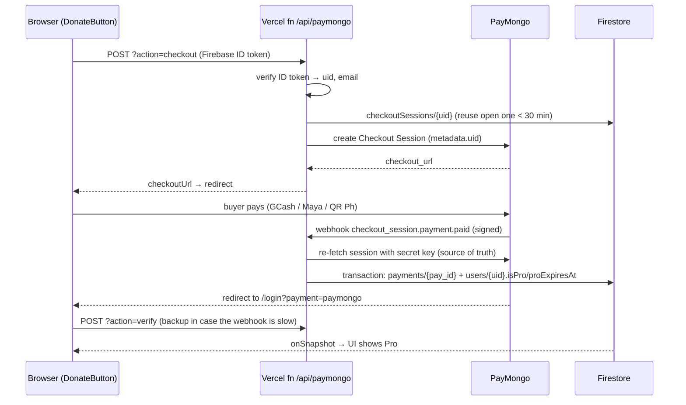

# Aullevo — PayMongo automatic Pro activation

> [!summary]
> GCash / Maya / QR Ph payments used one shared PayMongo link. After the first payment, every visitor saw that buyer's receipt and Payment ID, and anyone could paste the ID to claim Pro.
> Now each user gets their **own** PayMongo checkout from a Vercel function. PayMongo confirms the payment and the server turns on Pro automatically, and each payment can be used only once.

---

## 1. The original problem

**Symptom:** a brand-new account opened the GCash link and saw *"QRPh Payment Received!"* with someone else's `pay_…` Payment ID.

**Cause:**
- The button pointed to a hard-coded link: `https://pm.link/org-…/ZLLIimX`.
- **PayMongo payment links can be paid only once.** After that, the link shows the receipt to anyone who opens it.
- The `?email=…&uid=…` added to the link was **ignored by PayMongo**, so payments were never tied to an account.

**Why it was a security risk:**
1. **Payment ID reuse.** Anyone could copy the public `pay_…` ID and submit it from their own account. If I approved claims by checking only "does this ID exist in PayMongo?", I'd give Pro to the wrong person, possibly many times for one payment.
2. **Claim spam.** Any signed-in user could create unlimited fake claims. Not dangerous, since each needed manual approval, but it cluttered the queue and cost Firestore writes.

**What was already safe:** Firestore rules never let the browser write `isPro` / `proExpiresAt`, so nobody could give themselves Pro directly.

> [!tip] Lesson
> A static payment link can't tell buyers apart. Anything that has to belong to one user (checkout, receipt, activation) must be **created by the server for that user**.

---

## 2. How it works now



**Design rules to remember:**
- **Never trust the browser to grant Pro.** Only the server grants it, and only from data it fetched from PayMongo with the secret key.
- **Re-fetch, don't trust the webhook body.** Even a forged webhook can't do anything, because the server asks PayMongo directly.
- **Webhook signature check**, as extra protection: header `Paymongo-Signature: t=…,te=…,li=…`, where the signature is HMAC-SHA256 of `"{t}.{rawBody}"` using `PAYMONGO_WEBHOOK_SECRET`. Requests more than 10 minutes old are rejected.
- **Idempotent (safe to repeat):** `payments/{pay_id}` is written in the **same transaction** that extends Pro. If that record already exists, nothing happens. A payment can never be applied twice or to another account.
- **Two ways Pro gets turned on:** the webhook, *or* the `verify` call when the buyer returns to `/login`. Either one works alone.
- **Plans (added 2026-10-01):** `monthly` $2.50 / ₱154.29 → +30 days, `yearly` $20 / ₱1,234.32 → +365 days, `lifetime` $50 / ₱3,085.80 → `proExpiresAt` removed. The browser only sends `{plan}`; the **server's `PLANS` table decides the price**, writes the plan into the PayMongo session `metadata.plan`, and `fulfill` grants based on that plan and checks the paid amount is at least that plan's price. A session with no `metadata.plan` (from before plans existed) counts as `monthly`.
- **Extending:** a monthly/yearly payment adds its days on top of any remaining Pro time. Lifetime Pro (`isPro: true` with no `proExpiresAt`) is never shortened, and checkout returns 409 for a lifetime user.

---

## 3. Files involved

| File | What it does |
|---|---|
| `api/paymongo.ts` | The Vercel function: `checkout`, `verify`, `webhook` actions, plus `GET` health check |
| `api/tsconfig.json` | TS config for the function (Vercel also uses it when compiling) |
| `src/pages/DonateButton.tsx` | GCash button calls `/api/paymongo?action=checkout` and redirects. PayPal claims use a fixed ID of `paypal_<orderId>` |
| `src/pages/Login.tsx` | Handles `?payment=paymongo` / `?payment=cancelled` and calls `verify` up to 6× every 4 s |
| `firestore.rules` | PayPal-only claims, fixed claim IDs, `payments` readable by its owner, `checkoutSessions` server-only |
| `firebase.json`, `.firebaserc` | Let `firebase deploy --only firestore:rules` work |
| `vercel.json` | Catch-all redirect to the SPA now **excludes `/api/`** (`/((?!api/).*)`) |
| `scripts/setup-payments.mjs` | One-time setup (run with `npm run setup:payments`) |
| `.gitignore`, `.vercelignore` | Keep `*firebase-adminsdk*.json` keys out of git and Vercel uploads |

**Firestore collections:**
- `users/{uid}`: `isPro`, `proExpiresAt` (ISO string), `subscriptionPlan`, `lastPaymentId`, `lastPaymentProvider`
- `payments/{pay_id}`: record of each payment: uid, amount, method, `grantedUntil`, checkout session id
- `checkoutSessions/{uid}`: that user's current open checkout (`sessionId`, `checkoutUrl`, `status: open|paid`)
- `paymentClaims/paypal_{orderId}`: PayPal payments waiting for manual approval

---

## 4. Environment variables (Vercel → Production)

| Name | Where to get it |
|---|---|
| `PAYMONGO_SECRET_KEY` | PayMongo Dashboard → Developers → API Keys → **Secret key** (`sk_live_…`) |
| `PAYMONGO_WEBHOOK_SECRET` | Returned when the webhook is created (`whsk_…`); the setup script does this |
| `FIREBASE_SERVICE_ACCOUNT` | Firebase Console → Project settings → Service accounts → *Generate new private key* (stored base64-encoded) |
| `PAYMONGO_PAYMENT_METHODS` *(optional)* | e.g. `qrph,gcash,paymaya`. If unset, the server tries `qrph,gcash,paymaya`, then `qrph`, then `gcash,paymaya` |
| `VITE_PAYPAL_CLIENT_ID` | In `.env`. Public value, baked into the site at **build** time |

> [!warning] Secrets
> - `.env` **is committed to git**, so anything in it is public. Only put the PayPal *client ID* there, never secret keys.
> - Secret keys live **only** in Vercel env vars. Never paste them into chat.
> - Never keep a service-account `.json` inside the project folder. Move or delete it after setup.

---

## 5. Setup from scratch (checklist)

- [ ] Get the PayMongo **live secret key** (`sk_live_…`)
- [ ] Download a Firebase **service account key** (`.json`) for `aullevo-data`
- [ ] **Give that service account Firestore access** (see below; easy to forget)
  - Google Cloud Console → IAM → project `aullevo-data` → ✏️ on `firebase-adminsdk-fbsvc@aullevo-data.iam.gserviceaccount.com` → **Add another role** → **Cloud Datastore User** → Save
- [ ] Run `npm run setup:payments` in a real terminal. It:
  1. checks the PayMongo key (typing is hidden)
  2. creates or reuses the webhook → `https://aullevo-web.vercel.app/api/paymongo?action=webhook`
  3. checks the service-account file belongs to `aullevo-data`
  4. saves the three env vars to Vercel Production
  5. optionally deploys the Firestore rules and runs `vercel --prod`
- [ ] Open `https://aullevo-web.vercel.app/api/paymongo`. Everything under `configured` should be `true`, and `paymongoLiveMode: true`
- [ ] Make one real test payment with my own account; Pro should turn on within seconds
- [ ] Move the service-account `.json` out of the project folder

**Manual equivalents** (if the script ever breaks):
```bash
vercel env add PAYMONGO_SECRET_KEY production          # paste value when prompted
vercel env add FIREBASE_SERVICE_ACCOUNT production < key.json
vercel env add PAYMONGO_WEBHOOK_SECRET production
firebase deploy --only firestore:rules --project aullevo-data
vercel --prod
```
The webhook can also be created in the PayMongo Dashboard → Developers → Webhooks, with event `checkout_session.payment.paid`.

> [!note] Env var changes need a new deploy
> Vercel reads env vars when a deployment is created. After changing one, run `vercel --prod` again.
> IAM role changes (Google Cloud) take effect in about a minute with **no** redeploy.

---

## 6. Troubleshooting runbook

**Always start with the logs:**
```bash
vercel logs --environment production --since 30m --source serverless --expand
```
And the health check: `https://aullevo-web.vercel.app/api/paymongo`

| Symptom | Cause | Fix |
|---|---|---|
| Modal says **"Payments are temporarily unavailable."** and logs show `7 PERMISSION_DENIED: Missing or insufficient permissions` | Service account has no Firestore IAM role (ours only had *Firebase Authentication Admin*) | IAM → add **Cloud Datastore User** to the service account. The Admin SDK doesn't go through Firestore rules, so this is **IAM**, not `firestore.rules` |
| "Payments are temporarily unavailable." and health shows a `false` | Env var missing | `npm run setup:payments` again, then `vercel --prod` |
| **"The payment provider rejected the request"** (502) | PayMongo rejected the key or request | Check the key is right, live, and not revoked; the exact PayMongo error is in the logs |
| **"Failed to load PayPal SDK"** | Invalid `VITE_PAYPAL_CLIENT_ID`. Ours was **77 chars instead of 80** (copied incompletely). PayPal answered `client-id not recognized` | Copy the Client ID again from developer.paypal.com → Apps & Credentials → **Live**, update `.env`, run `vercel --prod` |
| Paid, but Pro didn't turn on | Webhook not arriving or failing | Check logs for `POST /api/paymongo`. Reopening `/login?payment=paymongo` retries `verify`. Check the webhook is **enabled** in PayMongo |
| `/api/...` returns the website HTML | The SPA catch-all redirect is swallowing `/api` | `vercel.json` source must be `/((?!api/).*)` |
| A payment method isn't offered | Not activated on the PayMongo account | Activate it in PayMongo or set `PAYMONGO_PAYMENT_METHODS` |

**Quick checks:**
- Is the PayPal client ID valid? `curl -s -o /dev/null -w "%{http_code}" "https://www.paypal.com/sdk/js?client-id=<ID>&currency=USD"` → `200` = OK, `400` = invalid
- Test a **preview** deploy (not production) with `vercel`, then call it with `vercel curl "/api/paymongo" --deployment <preview-url>` (this gets past Vercel's login protection on previews)

> [!bug] Git Bash gotcha (Windows)
> Git Bash rewrites arguments that start with `/` into Windows paths (`/api/paymongo` → `C:/Program Files/Git/api/paymongo`), which made `curl` fail with *"URL rejected: Malformed input"*.
> Fix: `export MSYS_NO_PATHCONV=1` first, or use PowerShell.

---

## 7. Common maintenance tasks

- **Change a price or length:** `PLANS` in `api/paymongo.ts` (what PayMongo really charges, in centavos) **and** `PLANS` in `src/config/plans.ts` (what the site shows + the PayPal USD amount). Then the wording on the Docs/Terms/Privacy pages and the offers in `index.html`. Deploy.
- **Grant or remove Pro by hand:** Firebase Console → Firestore → `users/{uid}` → set `isPro` and `proExpiresAt` (ISO date string, e.g. `2026-10-29T12:00:00.000Z`). **Delete** `proExpiresAt` for lifetime. Set `subscriptionPlan` to `monthly` / `yearly` / `lifetime` so the Account page shows the right plan.
- **Approve PayPal payments (best way): https://aullevo-web.vercel.app/admin.** Sign in with the admin Google account. The **Pending** tab has a card per claim: *Open in PayPal ↗* → check the money arrived → pick the plan → **Approve** (or **Reject** with a reason). The card previews the exact expiry before you click. **History** shows every decision and who made it; **Users** shows everyone's plan and flags "no-expiry" accounts. *Check with PayMongo* on unfinished GCash checkouts grants Pro if they actually paid, or clears expired ones. Admins = `ADMIN_UIDS` env var on Vercel (comma list of Firebase uids); default is only my uid. Everything runs through `/api/paymongo?action=admin-*`, which checks the Google ID token + admin list and writes with the Admin SDK; the Firestore rules stay closed.
- **Security of approvals (2026-10-01 review):** a claim's amount/plan are typed by the buyer's browser and can be faked. With `PAYPAL_CLIENT_SECRET` (PayPal developer → Apps & Credentials → **Live** → Secret) set in Vercel, `/admin` asks PayPal for the real amount and status and the server refuses plans the payment doesn't cover, refunded/unknown payments, and reuse. Every approved PayPal payment writes `payments/paypal_<ID>` for its capture ID **and** order ID (uppercased), so one payment can't be approved twice. PayPal orders carry `custom_id` = `<plan>:<uid>` (since 2026-10-04; older ones are just `<plan>`), and the server refuses a claim whose uid doesn't match, so nobody can claim someone else's transaction ID. Admin calls check token revocation (Firebase console → Authentication → user → "Revoke"/disable kills admin access immediately). The function refuses to start in production if `FIREBASE_*_EMULATOR_HOST` is set. Without the PayPal secret the page shows a yellow "check by hand" warning on each claim.
- **Approve PayPal payments (terminal backup):** `npm run approve:payments` goes through pending claims one by one: check the shown Transaction ID in PayPal → Activity, then press `a` (approve), `r` (reject) or `s` (skip). Approving asks for the USD amount PayPal shows as received and refuses plans above it, and writes/checks the same `payments/paypal_<ID>` records as `/admin` (it can't check the account binding, so prefer `/admin`). It sets `isPro` / `proExpiresAt` / `subscriptionPlan` and marks the claim in one transaction. `-- --list` only shows them.
- **Approve a PayPal payment (by hand in the console):** the claim's `note` starts with the plan (`Monthly plan · …`, `Yearly plan · …`, `Lifetime plan · …`) and `amount` is what PayPal captured. Check the transaction in PayPal → set Pro on `users/{uid}` (+30 days, +365 days, or delete `proExpiresAt` for lifetime) → set the claim `status` to `approved`.
- **Refund a PayMongo payment:** refund in the PayMongo dashboard, then shorten or remove Pro on `users/{uid}` by hand. The `payments/{pay_id}` record shows who got what.
- **Rotate the service-account key:** Firebase → Service accounts → generate new key → `npm run setup:payments` → `vercel --prod` → delete the old key under Google Cloud → IAM → Service Accounts → `firebase-adminsdk-fbsvc` → **Keys**.
- **Rotate the PayMongo key:** roll it in PayMongo → `npm run setup:payments` → `vercel --prod`.

---

## 8. How we debugged it (the process)

1. **Reproduce and read the code.** Found the hard-coded `pm.link` and the ignored query params in `DonateButton.tsx`.
2. **Assess the risk** before fixing: what's already protected (Firestore rules on `isPro`) vs. what's exploitable (Payment ID reuse, claim spam).
3. **Design so the server is the only authority**: one checkout per user, webhook plus re-fetch, a payments record to prevent reuse.
4. **Test in layers:**
   - `tsc -b` typecheck, `firebase deploy --only firestore:rules --dry-run` (rules compile)
   - local run of the function: 12 checks (no token → 401, bad or old signatures → 401, invalid PayMongo key → 502, …)
   - a **preview** deployment to confirm Vercel builds `api/` alongside Vite and that routing works
5. **In production, read the logs first.** Two separate problems had the same "it's broken" symptom:
   - Firestore `PERMISSION_DENIED` → an IAM role was missing (a Google Cloud setting, not the code)
   - PayPal `client-id not recognized` → a mistyped `.env` value (77 vs 80 characters)

> [!tip] Lesson
> When something breaks right after a deploy, don't guess. Check **health endpoint → function logs → the third-party API's own error message**. Each error usually names its cause exactly.

---

## 9. Open follow-ups

- [ ] Deactivate the old PayMongo link `ZLLIimX` in the PayMongo dashboard
- [ ] Reject any other account that submits old claim ID `pay_EqvhCwZTAPPcz19RqRqsAavX` (it's mine: approved on my account 2026-10-01 as Monthly, Pro until 2026-10-29); review any claims left over from the old paste-the-ID flow. Accounts approved by hand with only `isPro: true` and no `proExpiresAt` show as **Lifetime**, so check for those too
- [ ] Restore `public/og-image.png` (deleted, but still used for social link previews by `index.html` and `SEO.tsx`)
- [ ] Move or delete `aullevo-data-firebase-adminsdk-fbsvc-*.json` from the project folder; optionally rotate that key, since an earlier `vercel --prod` may have uploaded it (private to my Vercel account)
- [ ] Remove unused `src/components/GlassWaterShader.tsx` if I'm happy with the new shader

---

## Appendix — homepage demo shader & liquid glass (same session)

- New background: `src/components/AullevoLatticeShader.tsx` (WebGL). It uses the logo's shapes: a triangle grid, falling "data rain" symbols (triangle, "O" ring, "E" bars), a lens effect around the mouse with a triangle-and-ring reticle, and pulses on click. A ghost cursor keeps it moving when the mouse is away. It pauses when off-screen and slows down for reduced-motion users.
- Tuning knobs in that file: `CELL_PX` (triangle size, default 34), `HOVER_MARGIN` (how far outside the demo the mouse is noticed, default 80), and the color palettes in the fragment shader (`dark…` / `light…` vec3 values).
- Liquid glass styles: `liquid-glass`, `liquid-glass-light` and `glass-chip` mixins at the top of `src/styles/_demo-animation.scss`. The cursor sheen comes from the `--glass-mx` / `--glass-my` / `--glass-hover` CSS variables, which `DemoAnimation.tsx` sets from mouse movement.
